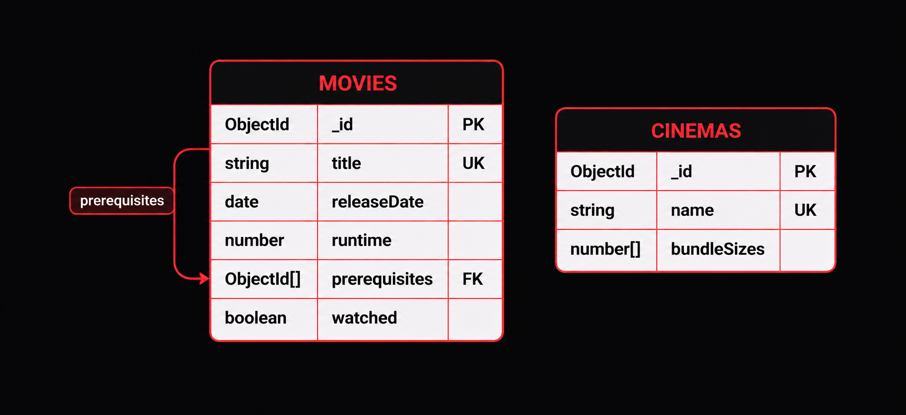

# Doomsday Ready

**Live Website:** [Doomsday Ready](https://doomsdayready.vercel.app/)

## Project Overview

Doomsday Ready is a full-stack web application where users can add, edit, and manage movies, set their prerequisite movies to watch, and track their rewatch progress. The application can detect circular dependencies and prevent invalid movie relationships.

It helps MCU fans organize movies, find the correct rewatch order, track their watching progress, and calculate the minimum number of cinema seat bundles needed for an opening-night watch party.

## Features

### Movies

- Add, edit, and delete movies.
- Set movie titles, runtimes, release dates, and prerequisite movies.
- Update movie prerequisites whenever needed.
- Mark movies as watched or unwatched.
- Detect and prevent circular dependencies between movies.

### Rewatch Plan

- Select a target movie to generate its rewatch plan.
- Display all required movies in a valid order, ensuring prerequisites come first.
- Show watched progress and the number of completed movies.
- Calculate the remaining watch time based on unwatched movies.

### Cinema Booking

- Add cinemas with their available seat bundle sizes (comma-separated).
- Select a cinema and enter a group size.
- Calculate the minimum number of bundles needed to accommodate the group exactly.
- Show how many bundles of each size are required.
- Handle cases where an exact seat combination is not possible.

## Tech Stack

**Frontend**
- Next.js
- React
- JavaScript
- Tailwind CSS

**Backend**
- Next.js API Routes (Route Handlers)
- Node.js
- MongoDB (Native Driver)

**Development**
- Docker
- Git

## Bonus Features

### 1. Data Model Diagram

Added a data model diagram showing how the Movies and Cinemas collections are structured and how movie prerequisites are connected.



### 2. Docker Compose

Added Docker Compose support to start the application with a single command:

```bash
docker compose up --build
```

## AI Usage

- AI tools were used during development for guidance, debugging, reviewing implementation approaches, and assistance with documentation.
- The application logic, API implementation, database integration, and frontend were developed and tested as part of this assessment.
- AI tools were also used to create test datasets and make repetitive tasks easier.

## Environment Variables

The `.env.example` file is publicly available and includes the test database connection details to make it easier for reviewers to run and test the application locally. The file is intentionally included in the repository for assessment purposes.

## Planned Improvements

- Secure API routes using authentication and authorization with cookies and JWT.
- Implement Firebase Authentication for secure login and user management.

